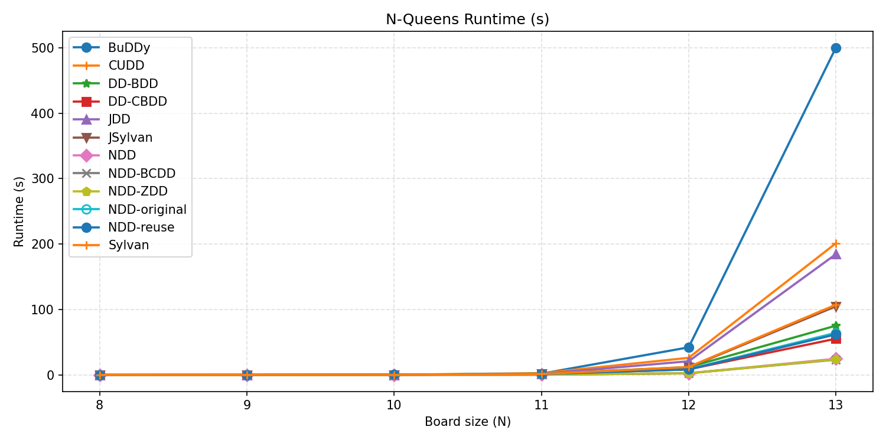
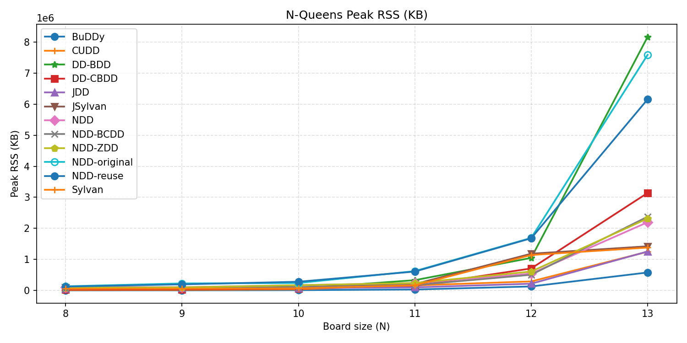

# NQueens Benchmark for BDD and NDD libraries 

The benchmark compares pinned upstream BuDDy, CUDD, Sylvan, JDD (BDD and
ZDD), JSylvan, Microsoft DecisionDiagrams (BDD and chain-reduced BDD), and
XJTU-NetVerify NDD (original, reuse, and maintained BDD/BCDD/ZDD label modes).

## Current results

`results/` contains only the latest N=8?13 run across the 12 default targets
and its six plots. The run used two Sylvan workers and a 500-second timeout:
71 runs returned the expected solution count; BuDDy timed out at N=13.
Historical result files have been removed. To reproduce this run:

```powershell
.\scripts\run_nqueens_wsl.ps1 --workers 2 --output results/nqueens_metrics.csv
```






## How to run the benchmark

Active targets use pinned, unmodified upstream library sources with adapters in
[`benchmarks/`](benchmarks/README.md). Exact URLs and commits are recorded in
[`benchmarks/upstream-lock.json`](benchmarks/upstream-lock.json). The archived
SoA targets remain custom legacy implementations. Adapter binaries are generated
under ignored `.bench-build/`; builds reject edits to tracked upstream files.

### Windows with WSL Ubuntu

The native implementations require Linux build tools. With Ubuntu in WSL, install
the dependencies inside Ubuntu:

```bash
sudo apt update
sudo apt install build-essential cmake pkg-config libgmp-dev openjdk-17-jdk maven python3-matplotlib python3-psutil dotnet-sdk-6.0
```

From PowerShell at the repository root, run the 12 default implementations:

```powershell
.\scripts\run_nqueens_wsl.ps1 --sizes 8 9 10 --output results/nqueens_metrics.csv
```

After the implementations have been built, add `--skip-build` to reuse them.
The launcher selects Java 17 and Ubuntu's Python packages. `--targets all`
runs all 13 upstream implementations, including ZDD, which is excluded from
the default list. The script saves CSV results and
generates plots.

### Deprecated and legacy NDD-SoA targets

NDD retains the SoA node-storage design and is the maintained benchmark
replacement. The following historical targets have been removed from the runner:

Their Maven project and source are archived under
[`deprecated/NDD-SoA/`](deprecated/NDD-SoA/). See
[`deprecated/README.md`](deprecated/README.md) for details.

| Historical target | Status | Recommended target |
| --- | --- | --- |
| `NDD-SoA` | Deprecated | `NDD` |
| `NDD-SoA-BCDD` | Deprecated | `NDD-BCDD` |
| `NDD-SoA-FD-ZDD` | Legacy experiment | No direct equivalent |

The finite-domain ZDD variant models a field as a set of concrete values;
NDD's ZDD mode models Boolean bit assignments. They are not interchangeable.
Archived source, tests, dependencies, and project documentation are retained;
generated build outputs and historical benchmark results have been removed.
The active runner no longer builds or executes these archived targets.

### Upstream original NDD

`NDD-original/` is a submodule of
[XJTU-NetVerify/NDD's ndd-original branch](https://github.com/XJTU-NetVerify/NDD/tree/ndd-original),
checked out at `943476cb4df17d593b28ac7703c0a5d886df847a`. The benchmark target
is named `NDD-original`. It replaces the Augists revision `96b2628`; historical
CSVs named this target `NDD` before the maintained implementation was renamed.

The upstream example hardcodes N=12, so the runner uses the repository-owned
`benchmarks/ndd/NDDObjectBenchmark.java` driver to construct the same model through
public APIs. The driver is compiled under `.bench-build/NDD-original/`; no library
source overlay is used. Lifetime allocation counters are unavailable and left
blank. Live-node metrics count distinct nodes reachable from the final root.

```powershell
.\scripts\run_nqueens_wsl.ps1 --targets NDD-original --sizes 13 --timeout 100 --output .bench-build/experiments/original/nqueens_n13_metrics.csv
```

### Upstream NDD reuse branch

`NDD-reuse/` is a submodule of
[XJTU-NetVerify/NDD's reuse branch](https://github.com/XJTU-NetVerify/NDD/tree/reuse),
checked out at `0a0811fce50d1d06669e90a7a9779b34dc1a6632`.
The `NDD-reuse` benchmark builds its bundled JDD sources directly with Maven and
uses the same public-API driver as `NDD-original`, compiled against its own JAR.
No upstream source files or compiled library classes are patched. Allocation
counters are unavailable; reachable NDD and label BDD counts are reported.

```powershell
.\scripts\run_nqueens_wsl.ps1 --targets NDD-reuse --sizes 13 --timeout 100 --output .bench-build/experiments/reuse/nqueens_n13_metrics.csv
```

### Maintained upstream NDD

`NDD` benchmarks [XJTU-NetVerify/NDD](https://github.com/XJTU-NetVerify/NDD)
alongside the existing NDD variants. It is included in both the default targets
and `--targets all`. The `NDD/` directory is a Git submodule, initialized with
`git submodule update --init --recursive` alongside BuDDy, CUDD, and the other
primary libraries. Its source is pinned to commit
`9c8eea1e086d84cc23e99eec1b240bb175714044` for reproducibility; advancing it
requires updating `benchmarks/upstream-lock.json` and the checkout to the same commit.
Builds require Git, Maven, and JDK 11 or later (the WSL launcher selects JDK 17).

To build and run just this implementation for N=13 with a 100-second timeout:

```powershell
.\scripts\run_nqueens_wsl.ps1 --targets NDD --sizes 13 --timeout 100 --output .bench-build/experiments/ndd/nqueens_n13_metrics.csv
```

Use `--skip-build` on subsequent runs to reuse its compiled adapter. The
repository-owned `benchmarks/ndd/NDDPrimitiveBenchmark.java` constructs the model
and records the public upstream NDD and label-node counters.

All three upstream label modes are included in the default target list and
`--targets all`. They share one build and appear separately in CSVs and plots:

| Benchmark target | Upstream label mode | Java argument |
| --- | --- | --- |
| `NDD` | `BDD` | default |
| `NDD-BCDD` | `COMPLEMENTED_BDD` | `--bcdd` |
| `NDD-ZDD` | `ZDD` | `--zdd` |

The existing `bdd_nodes_created` and `bdd_nodes_alive` CSV columns contain
label-node counts for the selected backend, including BCDD and ZDD labels.

Target names were simplified: `NDD-latest`, `NDD-latest-BCDD`, and
`NDD-latest-ZDD` are now `NDD`, `NDD-BCDD`, and `NDD-ZDD`. The former
`NDD` target is now `NDD-original`. Older target names are no longer registered in the runner.

To compare the three modes using the compiled JAR:

```powershell
.\scripts\run_nqueens_wsl.ps1 --skip-build --targets NDD NDD-BCDD NDD-ZDD --sizes 13 --timeout 100 --output .bench-build/experiments/ndd_modes/nqueens_n13_metrics.csv
```

### Dependency

Install build tools (pkg-config and GMP). Consider Debian/Ubuntu as an example:

```bash
sudo apt update
sudo apt install build-essential pkg-config libgmp-dev openjdk-17-jdk python3 python3-pip
```

Sylvan/JSylvan build will fail without pkg-config or libgmp-dev.

### Steps

1. Clone with submodules:
   ```bash
   git clone --recurse-submodules https://github.com/XJTU-NetVerify/nqueensBenchmarkDDs.git
   ```
   If cloned without `--recurse-submodules`, initialize them with:
   ```bash
   git -c core.autocrlf=false submodule update --init --recursive
   ```
2. run benchmark
   ```bash
   python3 scripts/run_nqueens_benchmarks.py
   ```
   - Board sizes default to N=8 through N=13; selected implementations are built automatically.
   - Use `--sizes 8 9 10`, `--workers 0` (autodetect), `--timeout 100`, or `--targets BuDDy Sylvan NDD` to select a subset. Omit `--targets` for the 12 defaults; `--targets all` includes all 13 upstream targets.
   - All results will be recorded in `results/nqueens_metrics.csv`
3. plot
   ```bash
   python3 scripts/plot_nqueens_results.py --input results/nqueens_metrics.csv --output results
   ```
   This generates six plots in `results/`: execution time and peak RSS (linear
   and log scales), nodes created, and final node count.

### Measurement schema

New runs use process wall time consistently in `time_sec`; optional adapter solve
time is stored separately in `solver_time_sec`. Rows include `status`,
`upstream_url`, and `upstream_revision`. Unavailable node counters and timeout
solution/node counters are blank. Plots omit missing measurements. These timing
and node-count definitions differ from historical CSVs; see the adapter README
for the per-library API definitions and version details.
