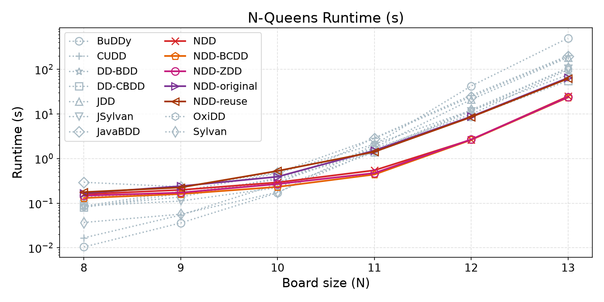
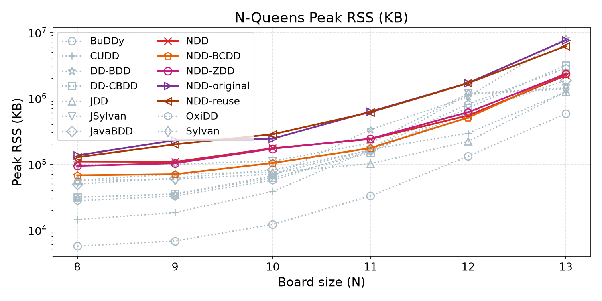
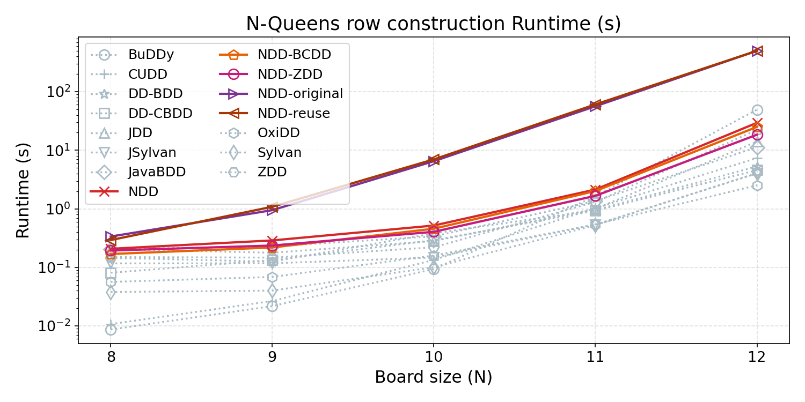
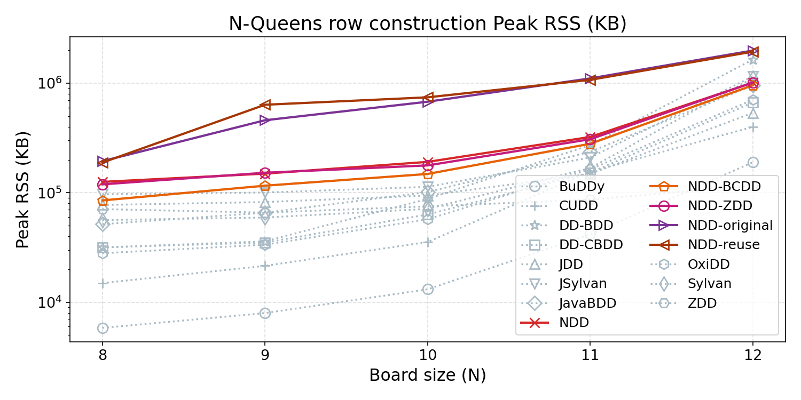

# N-Queens benchmarks for BDD and NDD libraries

Compare N-Queens construction across native C/C++, Java, and .NET decision
diagram libraries. Each run records elapsed time, peak memory, available node
counters, and the solution count.

Primary libraries are Git submodules pinned to upstream commits. Benchmark
adapters live in [`benchmarks/`](benchmarks/README.md), separate from upstream
source. Exact source URLs and revisions, including build dependencies, are
recorded in [`benchmarks/upstream-lock.json`](benchmarks/upstream-lock.json).

## Setup

Clone the repository with its submodules:

```bash
git clone --recurse-submodules https://github.com/XJTU-NetVerify/nqueensBenchmarkDDs.git
cd nqueensBenchmarkDDs
```

For an existing checkout:

```bash
git -c core.autocrlf=false submodule update --init --recursive
```

Native targets require Linux build tools. On Windows, use Ubuntu in WSL and
install the dependencies inside Ubuntu:

```bash
sudo apt update
sudo apt install git build-essential cmake pkg-config libgmp-dev time openjdk-17-jdk maven python3-venv python3-matplotlib python3-psutil
```

The DecisionDiagrams adapter targets `net6.0`. Install the .NET 6 SDK and runtime
in the same Linux environment, and check that `dotnet --info` finds them.

The OxiDD adapter requires Rust 1.91 or newer (`cargo` and `rustc`) in the same
Linux environment. Its Rust dependencies are pinned in
[`benchmarks/oxidd/Cargo.lock`](benchmarks/oxidd/Cargo.lock).

The PowerShell launcher uses the Ubuntu distribution named `Ubuntu`, selects
Java 17 from `/usr/lib/jvm/java-17-openjdk-amd64`, and uses Ubuntu's Python
packages. For a separate Python environment, install the dependencies from
[`requirements.txt`](requirements.txt):

```bash
python3 -m venv .venv
.venv/bin/python -m pip install -r requirements.txt
```

## Run

From PowerShell at the repository root, reproduce the retained benchmark:

```powershell
.\scripts\run_nqueens_wsl.ps1 --workers 2 --output results/nqueens_metrics.csv
```

From Linux, with Java 17 and the other tools on `PATH`:

```bash
python3 scripts/run_nqueens_benchmarks.py --workers 2 --output results/nqueens_metrics.csv
```

Use `.venv/bin/python` in place of `python3` if using the virtual environment.
The runner builds selected implementations, runs them sequentially, writes the
CSV, and generates two log-scale plots in the CSV's directory. An output path under
`results/` replaces the corresponding retained CSV and plots.

| Option | Default | Purpose |
| --- | --- | --- |
| `--benchmark` | `pairwise` | Construction strategy: `pairwise` or `rows` |
| `--sizes` | `8 9 10 11 12 13` | Board sizes to run |
| `--targets` | 14 targets below | Select target names; `all` adds standalone ZDD |
| `--workers` | `0` | Sylvan/JSylvan/OxiDD workers; 0 enables autodetection |
| `--timeout` | `500` | Timeout in seconds for each implementation and size |
| `--output` | `results/nqueens_metrics.csv` | CSV path; plots go beside it |
| `--skip-build` | Off | Reuse existing build artifacts |

For a quick run that preserves the retained results:

```powershell
.\scripts\run_nqueens_wsl.ps1 --sizes 8 10 --workers 2 --output .bench-build/experiments/smoke/nqueens_metrics.csv
```

To compare the three maintained NDD label modes at N=13:

```powershell
.\scripts\run_nqueens_wsl.ps1 --targets NDD NDD-BCDD NDD-ZDD --sizes 13 --workers 2 --timeout 100 --output .bench-build/experiments/ndd/nqueens_metrics.csv
```

To run only JavaBDD with its pure Java `JFactory` backend:

```powershell
.\scripts\run_nqueens_wsl.ps1 --targets JavaBDD --output .bench-build/experiments/javabdd/nqueens_metrics.csv
```

To run only OxiDD with two worker threads:

```powershell
.\scripts\run_nqueens_wsl.ps1 --targets OxiDD --workers 2 --output .bench-build/experiments/oxidd/nqueens_metrics.csv
```

Add `--skip-build` after a successful build. Builds and runs verify the pinned
upstream revisions and reject edits to tracked upstream source files. Adapter
builds and additional pinned Lace/Sylvan dependencies are stored under ignored
`.bench-build/` directories; Maven and .NET also create normal library build
outputs.

## Implementations

All targets below run by default except standalone `ZDD`. `--targets all` runs
all 15 targets. NDD targets appear last in the default run order.

| Target | Source directory | Implementation |
| --- | --- | --- |
| `BuDDy` | `BuDDy/` | Native BDD |
| `Sylvan` | `sylvan/` | Parallel native BDD |
| `CUDD` | `cudd/` | Native BDD |
| `OxiDD` | `oxidd/` | Rust BDD with index-based manager |
| `JDD` | `jdd/` | Java BDD |
| `JavaBDD` | `JavaBDD/` | Pure Java BDD (`JFactory`) |
| `ZDD` | `jdd/` | Java ZDD; explicit selection only |
| `JSylvan` | `jsylvan/` | Java binding to native Sylvan |
| `DD-BDD` | `DecisionDiagrams/` | .NET BDD |
| `DD-CBDD` | `DecisionDiagrams/` | .NET chain-reduced BDD |
| `NDD-original` | `NDD-original/` | Object-based NDD from upstream `ndd-original` |
| `NDD` | `NDD/` | Maintained NDD with BDD labels |
| `NDD-BCDD` | `NDD/` | Maintained NDD with `COMPLEMENTED_BDD` labels |
| `NDD-ZDD` | `NDD/` | Maintained NDD with ZDD labels |
| `NDD-reuse` | `NDD-reuse/` | Object-based NDD from upstream `reuse` |

All eleven source directories are submodules. The three maintained NDD modes
share one library build. JSylvan uses pinned Sylvan 1.4.1; standalone Sylvan
uses 1.9.1. See the [adapter documentation](benchmarks/README.md) for provenance,
build details, and counter APIs.

## Current results

[`results/nqueens_metrics.csv`](results/nqueens_metrics.csv) contains the retained
N=8 through N=13 results across the 14 default targets, with two workers for
Sylvan, JSylvan, and OxiDD and a 500-second timeout. Of 84 runs, 83 returned the expected solution count;
BuDDy timed out at N=13. Every completed N=13 run returned 73,712 solutions.
These are single-run observations, not averages over repeated trials.
The six JavaBDD measurements were added in a separate run on November 6, 2026,
using the same Ubuntu WSL environment, Java 17, and 500-second timeout; the
original 72 measurements were retained. JavaBDD uses the pinned `JFactory`
backend and returned the expected solution count for every board size.
The six OxiDD measurements were added in another run on November 6, 2026,
in the same Ubuntu WSL environment, using a Rust 1.91 release build, two worker
threads, and a 500-second timeout. All six returned the expected solution count;
the earlier 78 measurements were retained.

**Results at N=13**

| Library | Language | Execution time (s) | Peak memory (MiB) |
| --- | --- | ---: | ---: |
| BuDDy | C | Timeout (500 s) | 566.8* |
| Sylvan | C | 107.328 | 1,350.1 |
| CUDD | C | 201.200 | **1,219.2** |
| JDD | Java | 184.539 | 1,227.1 |
| JSylvan | Java | 104.900 | 1,390.2 |
| DD-BDD | C# | 75.338 | 7,972.3 |
| DD-CBDD | C# | 55.448 | 3,066.8 |
| NDD-original | Java | 64.405 | 7,408.7 |
| NDD | Java | 24.810 | 2,146.6 |
| NDD-BCDD | Java | **23.448** | 2,320.9 |
| NDD-ZDD | Java | 23.875 | 2,263.5 |
| NDD-reuse | Java | 62.014 | 6,009.9 |
| JavaBDD | Java | 193.776 | 1,814.8 |
| OxiDD | Rust | 97.948 | 2,762.6 |

Bold values are the lowest among completed runs. Values are rounded from the
CSV; memory is converted from KiB to MiB.
*BuDDy's memory is sampled peak RSS before timeout; its 500-second limit is
not a completed execution time.*

The pairwise CSV has two plots with logarithmic vertical axes:

- [Execution time (log scale)](results/nqueens_time_sec_log.png)
- [Peak memory usage (log scale)](results/nqueens_max_rss_kb_log.png)





To regenerate plots without rerunning the benchmark:

```bash
python3 scripts/plot_nqueens_results.py --input results/nqueens_metrics.csv --output results
```

## Row construction benchmark

The `rows` benchmark ports the construction in
[`SSoelvsten/bdd-benchmark/src/queens.cpp`](https://github.com/SSoelvsten/bdd-benchmark/blob/3c521e16ada406d37ae5f960096a567a41df33b9/src/queens.cpp)
to all libraries listed above, including every NDD variant. Each placement fixes
one square to true and every attacking square to false. Placements are combined
with OR within a row; the row diagrams are combined with AND. Variables retain
row-major order. This avoids the original benchmark's pairwise implications.

Run it with the same library revisions and settings as the original benchmark:

```powershell
.\scripts\run_nqueens_wsl.ps1 --benchmark rows --workers 2
```

Or from Linux:

```bash
python3 scripts/run_nqueens_benchmarks.py --benchmark rows --workers 2
```

For a short comparison on selected libraries that preserves the retained results:

```powershell
.\scripts\run_nqueens_wsl.ps1 --benchmark rows --targets CUDD NDD NDD-BCDD NDD-ZDD --sizes 8 10 --workers 2 --output .bench-build/experiments/rows-quick/nqueens_metrics.csv
```

The default output is [`results/rows/nqueens_metrics.csv`](results/rows/nqueens_metrics.csv),
with two log-scale plots and [`benchmark.json`](results/rows/benchmark.json) alongside it.
`--sizes`, `--targets`, `--timeout`, `--output`,
and `--skip-build` work for both strategies. Standalone JDD `ZDD` remains optional
and is included by `--targets all`.

The native BDD adapters, JDD, JavaBDD, JSylvan, and DecisionDiagrams use ITE to
build placement diagrams from the last variable to the first. NDD builds the
same placement cubes using its field-aware Boolean API; its ZDD mode still means
ZDD **labels**, while standalone JDD ZDD represents sets of occupied squares.
Unconstrained bits in standalone ZDD placements include both choices.

This is a port of the external construction strategy using this repo's library
pins, initialization, memory settings, and measurement methods. Its timings can
differ from the external suite's own executables. Charts continue to show full
process time; `solver_time_sec` is retained where the adapter reports it.
Failed row runs have `status=error`, blank solution/node fields, and are omitted
from plots. Completed sizes are saved incrementally. The original `pairwise`
benchmark remains the default and writes to its original output path.





## Measurements

- `benchmark` identifies `pairwise` or `rows` in newly generated CSVs. The retained
  original CSV predates this column and contains only pairwise results.
- `time_sec` measures process wall time, including runtime startup and metrics
  output. `solver_time_sec` records internal solve time where available.
- `max_rss_kb` is kernel-reported peak RSS from GNU time on Linux. Timeouts and
  other platforms use sampled process-tree RSS, which can miss brief peaks.
- `nodes_created` reports lifetime allocations where upstream provides a counter.
  Missing counters are blank; current table sizes are not substituted.
- `nodes_alive` follows each library's final graph-count API. Counting conventions
  differ, so these values are not interchangeable measures of memory.
- `ndd_*` and `bdd_*` split graph layers when available. For NDD, `bdd_*` includes
  the selected label backend, including complemented BDD and ZDD labels.
- `status` distinguishes completed runs (`ok`), timeouts (`timeout`), and failed
  row runs (`error`). Failed/timeout solution and node fields are blank; their
  recorded process duration is not a completed solve time.
- `upstream_url` and `upstream_revision` identify the pinned source for each row.

See [measurement details](benchmarks/README.md#measurements) and the
[implementation comparison](docs/bdd-implementation-comparison.md) for context.

## Validation and archived code

Run the benchmark contract tests in the configured Python environment:

```bash
python3 -m unittest discover -s tests -v
```

The historical SoA project remains under [`deprecated/NDD-SoA/`](deprecated/NDD-SoA/).
Its targets have been removed from the runner, including `--targets all`.
`NDD` and `NDD-BCDD` replace the corresponding SoA variants. The archived
finite-domain ZDD experiment has no direct equivalent in the maintained Boolean
ZDD label mode. See [`deprecated/README.md`](deprecated/README.md).
